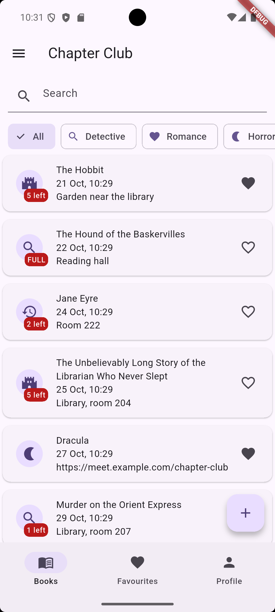
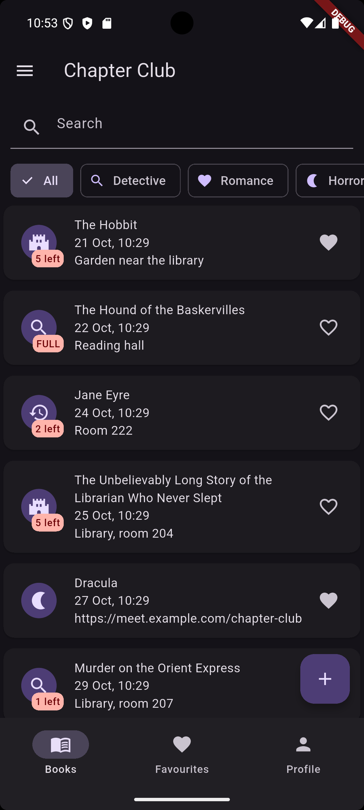
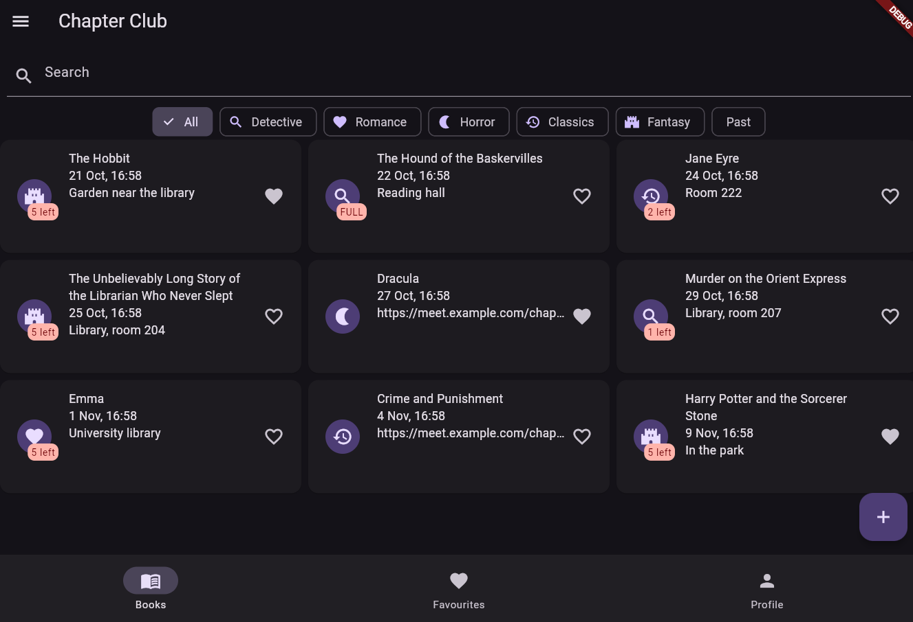

# chapter_club

A reading club app: a list of books with a meeting date, a genre and a limit of copies. You can borrow and return a book, add, edit and delete books, search and filter the list, and mark favourites. All data lives in memory (no network, no storage).

# screenshots
| Phone, light | Phone, dark | Tablet, grid |
| --- | --- | --- |
|  |  |  |

# decisions
he list of books and the profile live in the State of `HomeShell`,because three
tabs and the pushed screens all need the same data, so the tabs receive it as
constructor parameters and send changes up through callbacks. The detail screen
receives the book and callbacks through its route arguments because it can change
a book (borrow, return, delete) but should not know where the list is stored,
while the form returns a new `Book` through `pop` because it only produces a value
and the caller decides what to do with it. The list tab uses a `LayoutBuilder`
instead of `MediaQuery` because the grid should depend on the width that the tab
actually gets, not on the width of the whole screen. `PopScope` compares the
current field values with a snapshot taken when the form opened, so a form that was
changed and then changed back does not ask "Discard changes?". Lists are never
changed in place: every change builds a new list with `copyWith`, and `Book` hides
its readers behind an unmodifiable getter. With the tools of week 9 I would move
the data out of the shell state into a separate store, so that the screens do not
depend on `HomeShell` and the callbacks disappear.

